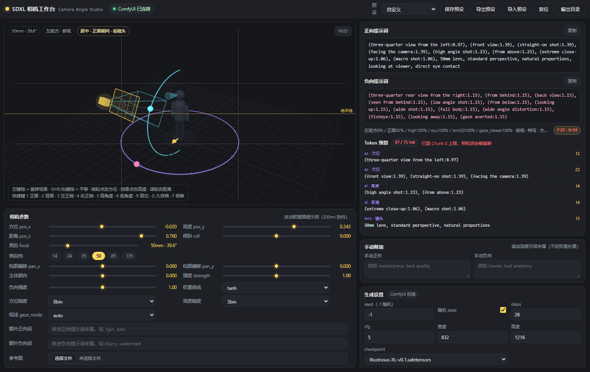
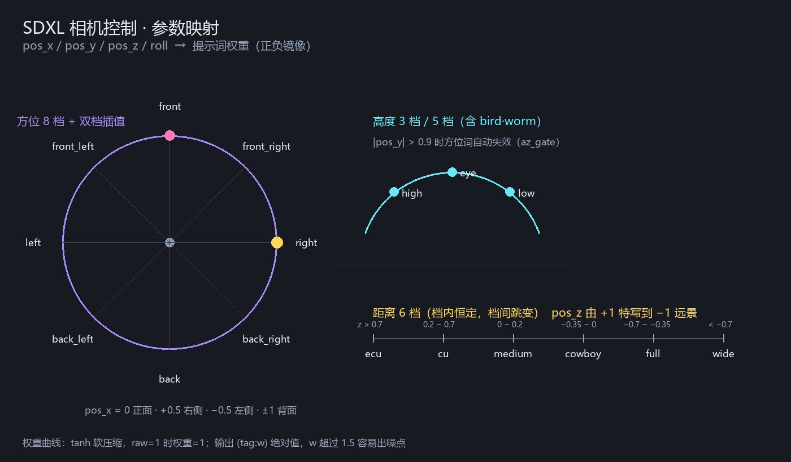

# SDXL 相机控制（CameraAngleSDXL）

把 [Comfyui-Anima_camera_angle](https://github.com/xunying7860/Comfyui-Anima_camera_angle) 的
「相机角度控制」原理移植到 **SDXL**，并补上手调摄像机直接出图。

它的主体是**提示词权重生成器**：3D 相机参数 → 自然语言摄影术语 +
权重 → 拼成 `(tag:w), (tag:w)` 丢给 CLIPTextEncode；同时产出**负向镜像**压制反方向。
不换模型、不加 LoRA；v2.3 起多一项**可选**能力：把 3D 视口导出的深度图 / OpenPose 骨架图
喂给你自己的 ControlNet（见 [v2.3 新能力](#v23-新能力controlnet-深度骨架--工作流嗅探--多机位批量)）。

```
pos_x / pos_y / pos_z / roll ──► CameraAngleSDXL ──► positive ──► CLIPTextEncode(正向) ──► KSampler
                                     │                   negative ──► CLIPTextEncode(负向) ──┘
                                     └── camera_info（JSON，接 3D UI / 调试）
```

## 两种用法

**① ComfyUI 插件节点**：把本目录放进 `ComfyUI/custom_nodes/`，画布上就有「SDXL 相机控制」节点，
输出 `positive` / `negative` 两根 STRING 接 CLIPTextEncode（工作流样例：`SDXL.CameraAngle.json`）。

**② 桌面相机工作台（`studio/`）**：独立小软件，3D 里拖摄像机 → 实时看正负提示词 → 直接提交 ComfyUI 出图，
还能把相机词注入你自己的生产工作流模板。不需要装进 ComfyUI，也不需要装任何第三方库。



```bat
REM 最省事：双击 studio\launch.bat（起服务 + 开浏览器）
studio\launch.bat              REM 默认 8770 端口，开浏览器标签页
studio\launch.bat --window     REM 用 Edge 无边框窗口，像桌面软件
studio\launch.bat --port 8790 --comfy http://127.0.0.1:8188
```

拖粉点改方位、拖青点改高度、滚轮改距离、滑块微调倾斜；右侧提示词实时刷新，点「生成图片」就落到画廊。
完整说明见 [studio/README.md](studio/README.md)。

四轴到提示词的映射（方位 8 档、高度 3/5 档、距离 6 档、倾斜）：



> 本仓库**不含任何示例成品图**：出图内容取决于你选的 checkpoint 与提示词，公开示例容易变成
> 成人内容，所以文档只用界面截图与原理示意图。想看效果就本地跑一张（工作台 → 生成图片）。


## 原仓库（Anima）原理：它到底做了什么

结论先行：**它不改模型、不加 LoRA、不接 ControlNet**。整个插件是一台「相机参数 → 提示词权重」
的文本编译器，跑在 CLIP 编码之前，与模型无关 —— 这正是它能原样迁到 SDXL 的原因。

源码分布：`camera_angle_node.py`（主节点 / 算法）、`camera_tag_config_node.py` /
`camera_weight_config_node.py` / `camera_extra_config_node.py`（三个纯配置节点，只把词表与乘数
打包成 JSON 传给主节点）、`js/camera_angle_widget.js`（three.js 3D 交互）。

1. **前端 3D 场景**：球体 + 三个手柄 —— 紫色圆环上的粉点 = 绕人转（方位 pos_x）、青色弧上的青点 =
   升降（高度 pos_y）、黄点 = 远近（距离 pos_z）；右下角「归位 / 标签」按钮。
2. **后端换算**（`camera_angle_node.py`，逐条照抄原始公式）：
   - **方位**：`az = pos_x * π`；`front=max(0,cos az)`、`back=max(0,-cos az)`、
     `right=max(0,sin az)`、`left=max(0,-sin az)`，四者和归一化成 ratio；
     `权重 = ratio * (az_weight + az_extra*extra_master) * az_gate`，
     门控 `az_gate = clamp((1-|pos_y|)/(1-0.9), 0, 1)` —— 相机抬到头顶时方位词自动失效。
   - **高度**：3 档硬判 `y>0.2 high / y>=-0.2 eye / else low`；
     `权重 = |y|*mult + extra*extra_master`，`mult = 15 if eye else 10`
     （eye 档故意留一个底噪权重）。
   - **距离**：6 档硬判 `z>0.7 ecu / >0.2 cu / >0.0 medium / >-0.35 cowboy / >=-0.7 full / else wide`；
     `权重 = 1 + extra*extra_master`，档内恒定，只在档间跳变。
   - **倾斜**：`roll > 0` 才输出 `dutch angle`。
   - 权重最后 clamp 到 `[weight_min=0.1, weight_max=10]`；短语里的逗号会被拆成多个 tag 分别加权。
3. **输出字符串**：`(from front:10.00), (high angle:7.50), (full body:1.00)` 这种 A1111 语法，
   直接接 CLIPTextEncode。

一句话：**相机 = 一组带权重的英文摄影词**。四轴各自贡献短语，权重表达「该方向的强调程度」，
反方向靠模型自己领会（原仓库没有负向输出）。它 README 里「XY 乘数别超过 2~3」说的就是别让权重爆：
raw 10 在 danbooru 底座勉强能用，在 SDXL 上会直接毁图（下一节讲原因）。

## 安装

1. 把整个 `sdxl_camera_angle/` 目录放进 `ComfyUI/custom_nodes/`：
   `ComfyUI/custom_nodes/sdxl_camera_angle/`
2. 重启 ComfyUI，节点出现在 **Anima/相机 → SDXL 相机控制**。
3. 接线：`positive` → 正向 CLIPTextEncode，`negative` → 负向 CLIPTextEncode，
   `camera_info` 可接 PreviewAny / ShowText 调试（纯 JSON，不影响出图）。

无 ComfyUI 也能单独跑核心算法：

```
python -c "import sys; sys.path.insert(0,'sdxl_camera_angle/core'); from camera_core import compute_camera; print(compute_camera(0,0,0,0))"
python sdxl_camera_angle/tests/test_core.py     # 纯 assert 自测
```

## 参数表

| 参数 | 类型 / 范围 / 步长 | 默认 | 说明 |
|---|---|---|---|
| `pos_x` | FLOAT -1..1 / 0.05 | 0.0 | 方位角，`θ = pos_x·π`。0 正面，0.5 正右侧，±1 背面 |
| `pos_y` | FLOAT -1..1 / 0.01 | 0.0 | 高度。>0.2 俯视，-0.2..0.2 平视，<-0.2 仰视；\|y\|>0.9 方位权重开始衰减 |
| `pos_z` | FLOAT -1..1 / 0.05 | 0.0 | 距离。>0.7 特写 / >0.2 近景 / ≥0 中景 / >-0.35 牛仔 / ≥-0.7 全身 / 更远 远景 |
| `roll` | FLOAT -1..1 / 0.10 | 0.0 | 倾斜，`roll_deg = roll×45`；|roll|>0.25 输出 dutch angle，负值 = 反向倾斜 |
| `focal` | FLOAT 8..400 / 1.0 | 50.0 | 等效焦距：14 超广角 / 24 广角 / 35 人文 / 50 标准 / 85 人像 / 135 长焦（同时决定 `fov_deg`） |
| `pan_x` | FLOAT -1..1 / 0.05 | 0.0 | 构图横移：>0 相机右移 → 主体偏左三分线，右侧留白 |
| `pan_y` | FLOAT -1..1 / 0.05 | 0.0 | 构图纵移：>0 主体压低（上方留白、地平线偏低），<0 主体抬高 |
| `subject_yaw` | FLOAT -1..1 / 0.05 | 0.0 | **主体朝向（世界坐标系）**：0 = 面向世界正前方，±0.45 侧身 3/4，±0.9 完全背对；实际朝向按 `rel_yaw = wrap(subject_yaw − pos_x)` 相对相机判定（机位转到背后时同一 yaw 会变成背身） |
| `gaze_mode` | auto / camera / away | auto | 视线：auto 按朝向与机位推导（含回眸）；camera 强制看镜头；away 强制看别处 |
| `preset` | COMBO（17 项） | 自定义 | 非「自定义」时**预设覆盖机位与光学参数**（滑块值仍留在 UI 上，动滑块会自动跳回自定义） |
| `strength` | FLOAT 0..2 / 0.05 | 1.0 | 权重曲线强度，0 = 全部中性（只剩裸短语） |
| `weight_mode` | tanh / linear / raw | tanh | tanh 推荐；linear 线性截断；raw 直通（调试对比用） |
| `azimuth_mode` | 8bin / 4bin | 8bin | 8bin = 8 方向 + 双档插值；4bin = 原仓库 cos/sin 四向分解 |
| `elevation_mode` | 3bin / 5bin | 3bin | 5bin 在 \|pos_y\|>0.75 时改用 bird / worm；两种模式在 \|pos_y\|>0.9 都锁存成 bird / worm（真顶视） |
| `neg_strength` | FLOAT 0..2 / 0.05 | 1.0 | 负向强度，**0 = 完全关闭负向**（输出空串） |
| `extra_positive` | STRING 多行 | "" | 原样追加到正向末尾 |
| `extra_negative` | STRING 多行 | "" | 原样追加到负向末尾 |
| `_cfg_json` | STRING | `{}` | 词表/参数覆盖（深合并），见下 |

输出：`positive` STRING、`negative` STRING、`camera_info` STRING(JSON)。

`camera_info` 示例（`compute_camera(0,0,0,0)`，节选）：

```json
{"azimuth_deg": 0.0, "elev_deg": 0.0, "fov_deg": 39.6, "focal": 50.0, "lens": "lens50",
 "bin": "front", "bins": [["front", 1.0, "az"], ["eye", 1.0, "el"], ["medium", 1.0, "di"],
                          ["lens50", 1.0, "lens"], ["gaze_viewer", 1.0, "gaze"]],
 "elevation": "eye", "distance": "medium", "dutch": false, "roll_deg": 0.0,
 "az_gate": 1.0, "pole_gate": 1.0, "azimuth_suppressed": false, "behind_ratio": 0.0,
 "framing": [], "subject": "subject_front", "gaze": "gaze_viewer",
 "subject_yaw": 0.0, "rel_yaw": 0.0, "pan": [0.0, 0.0],
 "tokens": {"positive": 44, "negative": 0, "total": 44, "limit": 75, "warn": 65, "level": "ok"},
 "preset": "自定义", "strength": 1.0, "weight_mode": "tanh",
 "azimuth_mode": "8bin", "elevation_mode": "3bin", "neg_strength": 0.0,
 "parts": [{"kind": "az", "key": "front", "ratio": 1.0, "raw": 10.0, "weight": 1.4,
            "phrase": "front view, straight-on shot, facing the camera",
            "tokens": ["(front view:1.40)", "(straight-on shot:1.40)", "(facing the camera:1.40)"]}],
 "negative_parts": []}
```

`bins` 是三元组 `[key, ratio, kind]`，`kind` ∈ `az/el/di/lens/tg/frame/subject/gaze` —— 只看方位就过滤 `kind == "az"`。
`parts[].tokens` 是最终写进提示词的字符串（含权重括号），可直接做 token 预算；
`camera_info.tokens` 就是相机段的预算结果（`clip_tokens` 估算，`level ∈ ok/warn/danger`）。

`_cfg_json` 覆盖示例（只写要改的键，其余走默认值，深合并）：

```json
{"front": "frontal view, dead-on shot",
 "neg": {"front": "rear view, facing away"},
 "weights": {"azimuth": {"weight": 7.0, "deadzone_ratio": 0.08}}}
```

## 预设表

| 预设 | (pos_x, pos_y, pos_z, roll) | 附加参数 | 实际档位 |
|---|---|---|---|
| 正面平视中景 | (0, 0, 0, 0) | — | front + eye + medium + 50mm |
| 正面仰视全身 | (0, −0.55, −0.5, 0) | — | front + low + full |
| 正面俯视中景 | (0, 0.55, 0, 0) | — | front + high + medium |
| 右侧90度中景 | (0.5, 0, 0, 0) | — | right + eye + medium |
| 背面全身 | (1, 0, −0.5, 0) | — | back + eye + full |
| 左前方45度近景 | (−0.25, 0, 0.35, 0) | — | front_left + eye + cu |
| 右后方45度中景 | (0.75, 0, 0, 0) | — | back_right + eye + medium |
| 虫瞰极限仰视 | (0, −1, −0.85, 0) | `elevation_mode=5bin, strength=0.7` | low（5bin → worm）+ full，方位关闭 |
| 鸟瞰极限俯视 | (0, 1, −0.85, 0) | `elevation_mode=5bin, strength=0.7` | high（5bin → bird）+ full，方位关闭 |
| 荷兰角倾斜中景 | (0, 0, 0, 0.45) | — | front + eye + medium + dutch(20°) |
| 特写面部 | (0, 0, 0.85, 0) | — | front + eye + ecu |
| **长焦人像85mm** | (0, 0, 0.1, 0) | `focal=85` | 85mm + 浅景深压缩 |
| **广角环境24mm** | (0, 0, −0.5, 0) | `focal=24` | 24mm 广角 + 环境叙事 |
| **三分法偏右** | (0, 0, 0, 0) | `focal=35, pan_x=−0.35` | 主体落右三分线 |
| **回眸背面机位** | (1, 0, 0.1, 0) | `focal=85, subject_yaw=−0.45, gaze_mode=camera` | back + 3/4 侧身 + 回眸 |
| **荷兰角负斜** | (0, 0, 0, −0.45) | `focal=50` | 反向倾斜 −20° |

后 5 条（加粗）是 v2 新增：光学焦距与构图/朝向的组合示例，配方在 `core/presets.py` 的 `PRESET_EXTRAS`。

## SDXL 权重为什么必须压缩

原节点直接把 raw 权重给到 **10**（A1111 语法 `(from front:10.00)`）。这在 danbooru 原生模型
（Anima / Illustrious 1.x 底座的习惯）里勉强能忍，但 SDXL 系的文本编码器对高权重的反应是
**非线性的、而且是坏的**：

- SDXL 是双文本编码器（CLIP-L + OpenCLIP-bigG），单个 token 加权后并入文本条件；
  权重 >1.6 时该 token 的向量会主导整段 caption，cross-attention map 变成单一方向的高斯斑 →
  **构图塌成贴图、边缘出现噪点/硬边、人脸与肢体结构断裂**。权重 10 基本等于
  "用这一个词覆盖整条提示词"。
- 出图不会"更听话"，只会**更糊**：模型被推到 embedding 空间的离群点，SDXL 的 U-Net
  没在那个区域训练过，于是给出高频噪点或平涂色块。
- 高权重还会挤掉风格词与负向词的份额（"a photo of ..." 再无作用）。

所以这里把 raw ∈ [0.1, 10] 用 **tanh 软饱和曲线**压到 SDXL 友好区间（实测 ≈[0.88, 1.40]）：

```
raw >= 1:  w = 1 + S*(raw-1)/((raw-1)+K)      # S=0.55*strength, K=3.3
raw <  1:  w = 1 - S*(1-raw)/((1-raw)+K)
```

- **软饱和**：raw 越大收益越小，永远逼近 1+S=1.55 而不越界；raw=10 只给 1.40，够"压住"
  但不会砸坏结构。
- **1.0 是中性点**：`|w-1| < 0.005` 时输出**裸短语**，不写 `(tag:1.00)`，保持 CLIP 输入干净。
- **两端都收**：raw<1（距离档、平视档）也温和地降到 0.88，形成"弱提示"而非"关掉"。
- 硬性不变量：**任何输出权重都在 [0.05, 2.0]**（单测做了 62 万个 token 的全域扫描）。

`strength` 缩放 S：0 = 全部中性（纯裸短语，等价于"只加词不加权"），2 = 上限抬到 1.55 附近。

## 与原 Anima 版的差异

| 项 | 原 Anima 版 | 本 SDXL 版 |
|---|---|---|
| 权重范围 | raw 直接到 10，clamp [0.1, 10] | tanh 压缩，输出恒定 ∈ [0.05, 2.0] |
| 权重 1.0 | 输出 `(tag:1.00)` | 输出**裸短语**，CLIP 更干净 |
| 方位 | 4 个离散方向（cos/sin 分解，跳档） | **8 方向 + 线性双档插值**（0.125 处 front / front_right 各 0.5），另有 4bin 对照模式 |
| 词表 | danbooru 惯用语（from front / facing left，SDXL 下语义易反） | 摄影术语（front view, straight-on shot / side view, profile view from the right） |
| 负向 | **无** | **正负向镜像压制**（对面方向 + 相邻轴反向），权重 1.15，neg_strength=0 可全关 |
| 平视档 | `\|y\|*15` → raw 15（danbooru 时代底噪 hack） | raw 固定 1.0 → 裸 `eye level shot`，不刷屏 |
| 距离 | 档内权重恒 1.0 | 档内仍跳变，但 `raw = 1 + 0.5*\|z\|`，极端档稍强 |
| 方位门控 | `(1-\|y\|)/0.1`，\|y\|>0.9 后线性衰减到 0 | 公式照抄，行为一致；az_gate 写进 camera_info 便于调参 |
| 倾斜 | roll>0 + 未被使用的 deadzone | roll>0 即出 dutch，`raw = 1 + 6*roll` |
| 输出 | 单 STRING（只正向） | 三路：positive / negative / camera_info(JSON) |
| 配置 | `_tags_json` 深合并 | `_cfg_json` 深合并（键名同源，另加 neg 与 weights 段） |
| 依赖 | 与 ComfyUI 混写 | `core/camera_core.py` **零 ComfyUI 依赖**，可单测；节点壳只做参数转换 |
| 手调摄像机 UI | 有（three.js） | 同原理的 3D UI（`js/sdxl_camera_widget.js`，任务 3） |

## 提示词长度：相机段必须留在第 0 块

SDXL 的两个文本编码器（CLIP-L 与 OpenCLIP-bigG）都是 **75 token/块**。ComfyUI 按块切分后逐块编码，
而 SDXL 的 **pooled 向量只取第 0 块**（`sd1_clip.py:50 first_pooled = pooled[0:1]`），文本塔又是因果
注意力 —— 所以相机词一旦被挤到第 1 块，pooled 里就没有它了，构图会明显失灵。

- **预算红线：相机段 65 token 标黄、75 token 封顶**。节点 3D 视口与 Studio 面板都实时显示 `44 / 75 tok`，
  超 65 变橙、超 75 变红 —— 超了不报错，CLIP 会静默截断，被砍掉的往往是排在后面的 `gaze`/`lens`；
- 每块 77 槽 = 1 BOS + 75 内容 + 1 EOS；**`(tag:1.40)` 的括号与权重不占 token**（tokenize 前剥离），
  但 **逗号占 1 token**。
- 本节点默认词表很紧凑：front 11 / front_right 7 / right 8 / back 9 / high 6 / eye 3 / low 9 /
  bird 10 / worm 9 / ecu 7 / cu 6 / medium 5 / cowboy 7 / full 3 / wide 10 / dutch 10 token。
  方位 1 条 + 高度 1 条 + 距离 1 条通常 15~30 token。
- **排布建议**：质量前缀 → 主体描述 → **相机段** → 场景/光照。用 `extra_positive` 追加的内容排在相机段
  **之后**，所以场景词放这里是安全的；前缀长度建议控制在 ~50 token 以内。
- 前缀 72 + 相机 53 = 125 token 就会切成 2 块，相机掉到第 1 块 → 出图失去角度控制。这是 SDXL 相机
  控制最常见的翻车点，不是权重问题。

## 权重语义（和 A1111 不一样的地方）

- `(x:1.40)` 是**绝对覆盖**，不是叠加：`((dutch angle:1.30))` 实测仍是 1.30；只有**裸** `(x)`
  才是 ×1.1（`comfy/sd1_clip.py:349 token_weights`）。
- **一个括号组只能有一个末尾冒号**：`(a:1.2, b:1.3)` 会被解析成 `[('a:1.2, b', 1.3)]`，数字直接残留
  进 token。所以每个短语必须**单独**套括号（本项目 `_emit` 就是按逗号拆开逐 tag 加权的）。
- `[x]` 在 ComfyUI 里**没有降权语义**（不是 A1111），只是两个多余 token。
- 权重的作用机制是**外插**：`z' = z_empty + w*(z - z_empty)`（`sd1_clip.py:63`），w 越大越往
  `z - z_empty` 方向推 —— 这就是 >1.5 出噪点/糊图的来源，也是本节点把 raw 压到 ≤1.40 的原因。
- 全部裸词时 `has_weights=False`，ComfyUI 会省掉一次空 prompt 编码（略快）。

## 手动调节摄像机出图

**方式一：节点滑块**（最快）。9 个机位/光学滑块 + 3 个档位开关：

- 机位：`pos_x`（绕人转）、`pos_y`（升降）、`pos_z`（远近）、`roll`（±45° 倾斜）
- 光学与构图：`focal`（8–400mm）、`pan_x` / `pan_y`（三分法偏移）
- 主体：`subject_yaw`（人朝哪，和机位无关）、`gaze_mode`（auto / camera / away）
- `preset` 选 16 个预设之一会**覆盖上面这些值**（含 focal/pan/yaw）；再动任意滑块自动跳回「自定义」。

**方式二：节点里的 3D 视口**（`js/sdxl_camera_widget.js` + `js/camera_shared.js`）。节点下方一块 three.js 画布：

- 粉色点（紫环上）→ 拖 = 绕人转方位；青色点（青弧上）→ 拖 = 升降高度；黄点（球外侧）→ 拖 = 远近；滚轮 = 整体推拉；
- 视锥线框随 `focal` 实时收放（FOV 由焦距算），叠加**九宫格 + 地平线**辅助构图，脚下箭头 + 视线锥表示 `subject_yaw`；
- 快捷键：`1` 正面 `2` 背面 `3` 左正侧 `4` 右正侧 `5` 高俯 `6` 低仰 `R` 重置 `G` 九宫格开关 `F` 视锥开关；
- 画布下方实时显示档位（如 `front_left · high · medium · 85mm`）、FOV 与正/负向预览，拖动即写回 node widget。

**方式三：桌面工作台**（`studio/`，双击 `studio/launch.bat`）。同一套算法 + 同一套常量（`js/camera_shared.js` 单一真源），
但带参考图叠层、多机位序列条、CLIP token 预算面板、预设导入导出，直接把图提交给 ComfyUI。

**方式四：工作流文件**。`workflows/SDXL.CameraAngle.json`（根目录也放了一份）是即插即用的完整图：
Checkpoint → LoRA(可删) → 相机节点 → 正/负 CLIPTextEncode → KSampler → VAE → SaveImage，
已通过结构校验（9 节点 13 连线，widget 顺序与 `INPUT_TYPES` 逐项对齐）。

**方式五：批量扫参数**。`tools/sweep_camera.py` 直接走 API：

```bash
python tools/sweep_camera.py --mode azimuth      # 9 个方位
python tools/sweep_camera.py --mode focal        # 14/24/35/50/85/135mm
python tools/sweep_camera.py --mode pan          # 三分法横移 × 纵向
python tools/sweep_camera.py --mode subject      # 朝向 / 回眸
python tools/sweep_camera.py --mode sequence     # 三视图 / 推拉序列
```

自动拼对比图 —— 用来标定你的底模到底吃不吃角度词。

**方式六：Start Studio 入口**。根目录 `start_studio.bat` 与 `studio\launch.bat` 等价（自动找 python，
找不到就回退 ComfyUI 便携版），双击即起服务 + 开浏览器。

## v2.3 新能力：ControlNet 深度/骨架 + 工作流嗅探 + 多机位批量

### 1. 3D 视口的深度图 / 骨架图（ControlNet 联动）

`js/camera_rig.js` 里 `CameraRig` 现在能在**离屏**渲染两张可直接当 ControlNet 输入用的图，
镜头与你在 3D 视口里调的那个机位**完全一致**：

| 方法 | 输出 | 口径 |
|---|---|---|
| `renderDepthDataURL(w, h, {invert:true})` | `data:image/png;base64,...` | ControlNet depth：**白 = 近，黑 = 远**，背景填远端（不会把空景标成贴脸） |
| `renderPoseDataURL(w, h)` | 同上 | OpenPose 18 点，右侧红 / 左侧蓝 / 中轴黄，黑底 |

工作台里的用法：右侧「ControlNet」卡 → 点「导出深度」或「导出骨架」→ 预览图出现 → 自动 `POST /api/controlnet/upload`
（后端用 ComfyUI 的 `/upload/image` 落到 `input/`，本地另存一份 `studio/state/controlnet/`）→
勾上「自动注入」后，提交时写进 `template_vars.controlnet_depth` / `controlnet_pose` + `controlnet_strength`。

`workflows/SDXL.CameraAngle.ControlNet.json` 是**双槽**示例：节点 10 吃 depth（0.65 / end 0.85），节点 13 吃 pose
（0.45 / end 0.6，串在 depth 下游），两个变量会分别落到这两个槽位。导出还会**按主体自动贴框**
（两轴取较大距离，横幅也不裁切），所以 depth 与 pose 的轮廓天然对齐。

实测（本机，512×768）：depth 导出 27.7 KB（白=近、四角纯黑、人物占 81% 画幅）、pose 26.1 KB，两者外接框中心偏差 0 px；
只发 depth → 出图是侧身白裙少女（轮廓贴合）；depth+pose 一起发 → 侧身 3/4 红大衣夜景，骨架与轮廓都吃住，
`/api/generate` 全程 `warn` 为空。

### 2. 任意 API 格式工作流嗅探

`studio/template_bridge.py` 不认死节点 id，按 `class_type` + 图结构回溯：

- 相机节点 `CameraAngleSDXL` → 直接把机位词写进它的 `extra_positive` / `extra_negative`；
- 正/负提示词顺 KSampler 的正负 conditioning 链**穿过** `ControlNetApplyAdvanced` / `ConditioningConcat` 找到真正的 `CLIPTextEncode`，只替换文本、不打断原有连线；
- 采样器 / latent / SaveImage / ControlNet 槽位全部认出来；
- 你选的是 **UI 格式**（ComfyUI 里直接保存的 JSON）会明确报「请 Workflow → Export (API)」，不会静默出错。

工作台「工作流模板」卡的下拉里选中一个模板 → 点「嗅探」→ 报告里能看到它认出了哪些节点、有没有 ControlNet 槽位、有什么风险提示。

### 3. 多机位批量队列

「批量队列」卡：选序列（三视图 / 环绕 8 机位 / 推拉 / 俯仰）→ 填 seed（`-1` 随机）→ 勾「同 seed」→ 提交。
后端 `POST /api/batch` 一次排队（上限 24 张），同 seed 时每张只换机位参数，出图后在 `#batch_grid`
里**并排对比**，点任意一张开大图。任务记录落 `studio/state/batches.json`（保留最近 50 条）。

### 4. 仓库工程化

- `pyproject.toml`（ComfyUI Registry 规范）+ `requirements.txt`（零第三方依赖）；
- `.github/workflows/ci.yml`：push/PR 自动跑门禁（python 3.10 / 3.12）；
- `tools/verify_repo.py`：仓库自检（关键文件、图片白名单、不该提交的目录、已下线脚本是否真删）；
- 发布脚本 `publish_github.py` / `recreate_public.py` / `publish_final.py` 与根 `发布到GitHub.bat` 已移到 `archive/`，只在需要时手动跑。

## 常见问题

| 现象 | 原因 | 处理 |
|---|---|---|
| 换了角度但出图几乎不变 | 相机词被挤到第 1 块 / 前缀太长 | 缩短前缀，把相机段往前挪 |
| 图糊、噪点、脸崩 | 权重过高（`weight_mode="raw"` 或 strength>1.5） | 用 `tanh` + strength 1.0 |
| 侧脸出成正脸 | Illustrious 系对 profile 词不敏感 | 拖到 `pos_x=±0.5`，或 `extra_positive="profile"` |
| 俯视/仰视没反应 | 高度词被方位门控压掉，或底模不认 `high angle` | `elevation_mode="5bin"` 走 bird/worm；负向加 `from below` |
| 负向里反向词互相打架 | `neg_strength` 过大 | 降到 0.5~0.8，或 0 关闭 |
| 拖 3D 视口没反应 | 前端扩展没缓存刷新 | 强制刷新浏览器；确认 `three.module.js` 与 JS 同目录 |
| 控制台刷 `PermissionError: [Errno 13] ... config.json.xxxx.tmp`、`POST /api/config 500` | 启动用的 python 是**低完整性**进程，而项目目录没给它写权限 | 见下面「写不进 state / out 目录」 |

### 写不进 state / out 目录（低完整性 python）

ComfyUI 便携版自带的 `python.exe` 是**低完整性进程**（mandatory label `S-1-16-4096`）。
Windows 的 No-Write-Up 规则规定：低完整性进程只能写**同等或更低**完整性标签的对象。所以：

- 在 `D:\QUARK\ComfyUI-aki-v3.2` 下跑一切正常——那棵树本来就在这个 sandbox 里；
- 项目搬到 `D:\DSh canera`（普通目录，中完整性）之后，`/api/config` 的临时文件就写不进去，
  日志里一直刷 `Permission denied`。

一行修法（对项目目录打低完整性标签，子项继承）：

```bat
icacls "D:\DSh canera" /setintegritylevel (OI)(CI)L
```

或者换解释器：用系统 python（中完整性）启动服务不会有这个问题，代价是
`tools/token_count.py` 拿不到 ComfyUI 的分词器，token 数退化成估算（`method: "estimate"`）。

体检脚本（用**真正启动服务的那只 python** 跑）：

```bat
"D:\QUARK\ComfyUI-aki-v3.2\python\python.exe" tools\check_env.py
```

代码侧现在也不会再 500：临时文件被拒时 `store.atomic_write_json` 退化成直接写目标文件，
仍失败则抛 `StoreWriteError`（带上面那句提示），`/api/config` 回
`200 {"ok": false, "message": "..."}`，界面把话显示出来而不是崩掉。

## 实拍验证（SDXL 真实出图扫描）

`tools/sweep_camera.py` 走 API 真实出图（WAI-Nsfw-Illustrious-17 + 固定 seed 20261117，768×1152 /
22 步 / euler_ancestral + karras），每组只改一个轴、其余锁死，自动拼成对比图：

| 扫描 | 图 | 结论 |
|---|---|---|
| 方位 9 档 | `out/grid_azimuth.jpg` | ✅ -1.00 纯背影 / -0.75 后方 3/4 / -0.50 左侧 profile / -0.25 左前 3/4 / 0 正面 / +0.25 右前 / +0.50 右侧 profile / +0.75 右后 3/4 / +1.00 纯背影，连续无跳档，方向正确 |
| 高度 7 档 | `out/grid_elevation.jpg` | ✅ 仰视侧 -0.9 / -0.6 / -0.3 渐变明显（越负越贴地仰拍）；⭕ 俯视侧 +0.3 / +0.6 / +0.9 三档几乎同图 —— 模型自带「俯视=近景」倾向把差别吃掉了，俯视想保留全身请把 pos_z 往负方向补 |
| 距离 6 档 | `out/grid_distance.jpg` | ✅ +0.9 脸部特写 / +0.5 近景 / +0.1 中景 / -0.2 牛仔（大腿以上）/ -0.5 全身 / -0.9 远景，档位单调递增、边界正确 |
| 预设 11 个 | `out/grid_preset_final.jpg` | ✅ 11 个预设全部命中（正面/仰视/俯视/右侧 90°/背面/左前 45°/右后 45°/荷兰角/面部特写/鸟瞰/虫瞰）；鸟瞰与虫瞰改词后从「抽象糊图」变成可信的极限俯仰视角 |
| 倾斜 6 档 | `out/grid_roll_v3.jpg` | ✅ roll=0 直立；0.2 起画面边框明显倾斜（荷兰角），0.4 之后趋饱和 —— 想要极端倾斜配 `roll 0.5~0.7` 就够 |
| 强度 7 档 | `out/grid_weight_v3.jpg` | ✅ strength 0→2.0 全程无噪点、无糊图（tanh 上限 1.4~1.55），只在方向感上有强弱差别；`strength=0` 等价于「只加词不加权」 |

### 一个真实踩坑：提示词里的 `camera` 会被画成相机

第一版词表里 `front` 是 `front view, facing the camera, straight-on shot`。跑出来 9 张里有 5 张画面里
**凭空出现一台单反相机**（有的还带三脚架），特写那张相机直接挡住嘴 —— 因为 Illustrious 系对
`camera` 这个词太敏感，1.40 的权重足以让它在构图里占一个实体。改成
`front view, straight-on shot, looking at viewer` 后消失。

教训：**权重词必须检查「字面实体化」风险** —— 方位词里别出现 camera / photo / lens 这类可画成
物体的名词。同理 `shot` 系列是安全的（`shot` 在摄影术语里指取景，模型不把它画成枪）。

### 词表演进（三轮实测）

| 轮次 | 老词 | 问题 | 改成 | 结果 |
|---|---|---|---|---|
| 1 | `front view, facing the camera` | 9 张里 5 张画出实体单反/三脚架，特写相机挡住嘴 | `front view, straight-on shot, looking at viewer` | 相机消失 |
| 2 | `dutch angle, canted camera, tilted horizon` | 荷兰角那张画面中央一台大镜头 | `dutch angle, canted framing, tilted horizon` | 只剩倾斜构图 |
| 3 | `bird's-eye view, top-down shot` / `worm's-eye view, extreme low angle` | 糊成粉色漩涡、头发炸开 | `from above, high angle, looking down at viewer, top-down view` / `from below, low angle, looking up at viewer` | 变成可信的顶视 / 贴地仰视 |

规律：**danbooru 系词表对 `from above / from below / looking at viewer` 这类「关系短语」
远比对摄影术语 `bird's-eye view` 敏感**；而任何含 `camera` 的词都会被实体化成道具。改词比调权重有效，
调权重比换模型有效。
复现任意一组：

```bash
"D:/QUARK/ComfyUI-aki-v3.2/python/python.exe" tools/sweep_camera.py --mode azimuth
# --mode elevation|distance|roll|weight|preset|focal|pan|subject|sequence|ab
# --tag v2 加后缀   --lora 0 关 LoRA   --focal 85 换光学档
```

已出过的图存在 `out/raw/` 下，重跑会自动复用（只补缺口）。
## 自测（四项门禁）

```bash
cd D:/QUARK/sdxl_camera_angle
export PYTHONIOENCODING=utf-8          # Windows 下中文输出必须

python tests/test_core.py              # 1) 17 组算法单测（含世界系 yaw、极点锁存、token 预算）
python tools/parity_check.py           # 2) Python ↔ js/camera_shared.js 常量/词表/预算逐字一致
python tools/validate_workflow.py workflows/SDXL.CameraAngle.json   # 3) 工作流 widgets ↔ 节点 INPUT_TYPES
python tools/verify_repo.py            # 4) 仓库自检（文件清单 / 图片白名单 / 目录洁净 / 下线脚本）

python studio/tools/check_ui.py        # 附加 a) 工作台静态契约
python studio/tools/e2e_test.py        # 附加 b) 工作台接口 + 真实出图（需要 ComfyUI 在线）
```

当前状态：**17 组单测全过 / parity TOTAL 差异 0 / 工作流 9 节点 13 连线全对齐 / verify_repo PASS 44 FAIL 0 /
check_ui 11 项 PASS / e2e --no-generate PASS 11 FAIL 0 SKIP 2**。CI 在 push / PR 时自动跑前四条。

单测覆盖：权重曲线校验值、8 档方位 + 双档插值、`az_gate`/`pole_gate` 门控、距离 6 档边界、
焦距 6 档 + FOV、roll ±45° 阈值、三分法构图、主体朝向与视线解耦（含回眸）、极点互斥词剔除、
负向开关、权重全域区间、16 预设 + 4 序列、cfg 深合并、camera_info 可 JSON 化。

> 本机没装 `pytest`，`test_core.py` 是自带 `main()` 的独立脚本，直接 `python` 跑。

## 已知边界

- 距离档位仍是**档间跳变**（沿用原仓库阈值），档内只有轻微的 `0.5*|z|` 增强；
  想要连续变焦请用 3D UI 微调 pos_z 或外接提示词。
- `elevation_mode="5bin"` 在 \|pos_y\|=0.75 处是硬切换（high ↔ bird），没有双档混合；
  3bin 也在 \|pos_y\|>0.9 处锁存到 bird / worm（`POLE_LATCH`），所以 3bin 拖到底同样是真顶视。
- SPEC 2.1 校验表里 `raw=0.5 → 0.92` 与曲线公式实际值 `0.93` 差 0.01：这里**按公式实现**
  （公式是准的，0.92 是手算笔误），单测断言 0.93。
- 焦距只改**透视语义与景深**，不真的移动相机；"退后拉近"要同时动 `pos_z`。
- `pan_x/pan_y` 是相机平移而非主体平移（`pan_x>0` → 主体偏左三分线）。两者混用会得到"主体没动但背景歪了"的图。
- `subject_yaw` 是**世界坐标系**朝向（v2.1 起）：早期按「相对相机」解释，背面机位 + yaw=0 会同时说人正对镜头
  和相机在背后；现在统一成 `rel_yaw = wrap(subject_yaw − pos_x)`，老参数想保持原效果请换算 `wrap(相对角 + pos_x)`。
- 极点区（\|pos_y\|>0.75）方位词会衰减/关闭，此时`pos_x` 基本无效 —— 这是刻意的，不是 bug。
  极点区还会把视线短语从 `looking at viewer` 换成 `looking up/down at the viewer`（`POLE_GAZE`），
  否则竖直机位会退化成「正面/背面站立」。鸟瞰（py>0.75）实测更偏高机位俯拍而非严格正上方顶视，
  3bin 在 \|pos_y\|>0.9 已锁存成 bird / worm（v2.1 `POLE_LATCH`），要更硬的顶视可再叠 `elevation_mode="5bin"` 并把 `strength` 提到 1.2 以上。
- `tools/parity_check.py` 是**静态正则**比对（本机无 node），能保证常量与词表一致，不能保证 JS 运行时无异常；
  运行时验证靠 `js/sdxl_camera_widget.js` 的桩环境实跑与工作台 `e2e`。

## 发布到 GitHub

仓库已经 `git init` 好、`.gitignore` 排除了出图与扫参产物，用原生 git 推即可（v2.3 起不再内置发布脚本，
个人 token 不该进公开仓库；旧脚本已归档在 `archive/`，只作历史参考）：

```bat
REM 1) 看这次要提交什么
git status --short

REM 2) 提交
git add -A
git commit -m "描述这次改动"

REM 3) 推到已有仓库（把 URL 换成你自己的；首次会提示输入用户名与 token）
git remote add origin https://github.com/<你>/<仓库>.git
git push -u origin main
```

token 推荐用 `gh auth login` 或凭据管理器保存，**不要**写进命令行或 `.git/config`：
提交前 `grep -c ghp_ .git/config` 应该是 0。

## 许可

MIT（见 [LICENSE](LICENSE)）。相机控制算法原理参考
[Comfyui-Anima_camera_angle](https://github.com/xunying7860/Comfyui-Anima_camera_angle)，
本仓库是独立的 SDXL 实现与桌面工作台。
